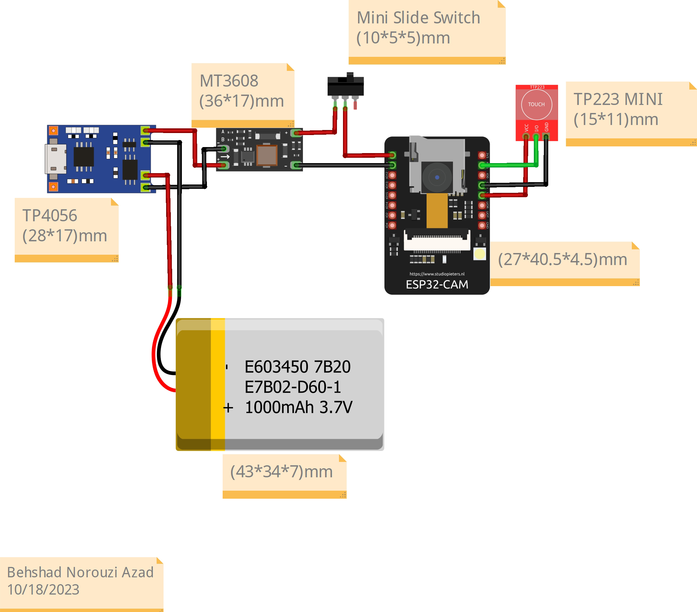
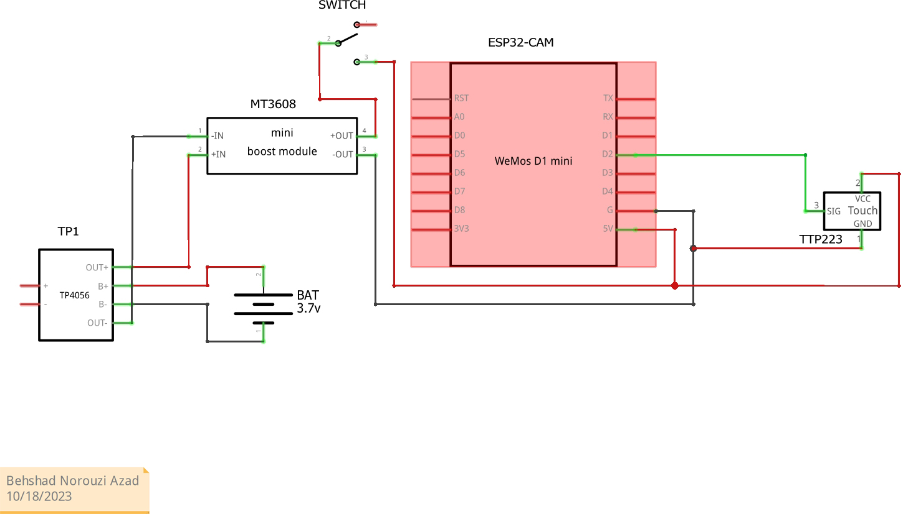

# Smart Glasses

[](https://github.com/behshadnorouzi/smart-glasses/actions/workflows/ci.yml)

Hardware prototype of camera glasses for visually impaired users. A small
camera on the frame captures what is in front of the wearer and streams it
over Wi-Fi to a nearby host (laptop, phone or mini PC). The host runs the
recognition and sends the result back as audio to an earphone. A touch pad
on the temple switches between modes, and a rechargeable Li-Po cell with a
charge/boost stage makes the glasses fully wireless.

This repository covers the electronics stage: part selection, power path,
wiring and bench-test tools. The goal was a working prototype built quickly
from parts available on the Iranian market.



## Hardware

| Part | Role | Size (mm) |
|------|------|-----------|
| ESP32-CAM (AI-Thinker) | Main board: camera interface, Wi-Fi/Bluetooth | 27 x 40.5 x 4.5 |
| OV2640 with extension flex | 2 MP camera, mounted on the frame | - |
| TP4056 module | Li-Po charging and battery protection | 28 x 17 |
| MT3608 module | Boost converter, battery to 5 V | 36 x 17 |
| TTP223 touch module | Mode selection | 15 x 11 |
| Mini slide switch | Power on/off | 10 x 5 x 5 |
| Li-Po 3.7 V 1000 mAh (603450) | Power source | 43 x 34 x 7 |
| FT232RL or ESP32-CAM-MB | Programming only | - |

Datasheets for every part are in [`docs/datasheets`](docs/datasheets).

### Power path

```
USB 5V --> TP4056 --> Li-Po 3.7V
              |
              +--> MT3608 (5V) --> switch --> ESP32-CAM 5V
                                         \--> TTP223 VCC
```

- **MT3608 to 5 V:** the ESP32-CAM accepts 3.3 V or 5 V, but with the camera
  running it is only reliable on the 5 V input, so the battery voltage is
  boosted instead of regulated down.
- **Battery:** the ESP32-CAM draws about 350-370 mA with the camera active.
  Adding the touch sensor and using datasheet figures, a 1000 mAh cell gives
  roughly 90 minutes of continuous use. A larger cell works too, at the cost
  of weight and size on the frame.

### Why these parts

**Main board.** Raspberry Pi Zero W was larger, more expensive, drew more
current and ran hot. XIAO ESP32S3 Sense was compact, but its camera was not available locally
and the external antenna was awkward to mount. The ESP32-CAM was the best
balance of size, price, availability and current draw, with Wi-Fi and
Bluetooth on board.

**Camera.** The OV2640 on a longer flex cable lets the camera sit on the
frame while the board sits on the temple. The default module on the
ESP32-CAM has a cable too short for that. The OV7670 was ruled out for its
bulky module, smaller image size and average quality.

## Repository layout

```
firmware/analog_monitor/   Arduino sketch that streams an analog input over serial
tools/serial_plot/         Live plotter for that stream (Python)
docs/                      Schematic, wiring diagram, datasheets, project presentation
```

## Bench tools

### `firmware/analog_monitor`

Prints `analogRead(A0)` 20 times per second at 115200 baud. Builds for AVR
and ESP32 boards. Change `kInputPin` for other boards. On the ESP32-CAM only
ADC2 pins are broken out (GPIO 2, 4, 12, 13, 14, 15), and ADC2 cannot be
read while Wi-Fi is active.

### `tools/serial_plot`

```sh
cd tools/serial_plot
pip install -r requirements.txt
python serial_plot.py --port COM10            # Windows
python serial_plot.py --port /dev/ttyUSB0     # Linux
```

Options: `--baud` (default 115200), `--window` (number of samples on screen,
default 300). Close the window to stop.

## Programming the ESP32-CAM

The board has no USB port. Use an ESP32-CAM-MB shield, or an FT232RL
adapter: 5 V to 5 V, GND to GND, TX to U0R, RX to U0T. Bridge IO0 to GND
while resetting to enter flash mode.

## Schematic



The schematic view uses a generic module symbol for the ESP32-CAM. The
wiring diagram above shows the actual board pins.

## License

Code is released under the [MIT License](LICENSE). Datasheets in
`docs/datasheets` belong to their respective manufacturers.
